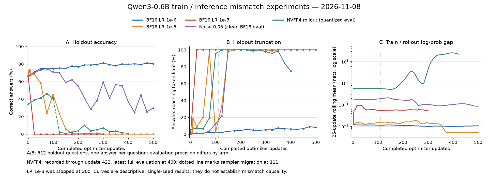

# 11月8日：训推不一致实验记录

分支：`tim/base`。本文保留运行方法和主要结果，完整记录见[详细版](README1108_DETAIL.md)。

## 共同参数

| 项目 | 设置 |
| --- | --- |
| 模型／算法 | Qwen3-0.6B Dense／GRPO |
| 训练数据 | GSM8K 2784题；保留同一题8次回答中答对2—6次的题 |
| 验证数据 | 独立512题，每题生成1个回答 |
| 每步采样 | 16题×8回答＝128条 |
| 训练步数 | 计划500步 |
| 优化器 | AdamW，恒定学习率，weight decay=0.01，β=(0.9,0.98) |
| 长度上限 | 回答1024 token，总上下文2048 token |
| 其他 | seed=42，关闭thinking；每25步验证，LR1e-5额外验证前10步 |

## 怎么运行

在仓库根目录执行，替换模型、数据、输出路径及空闲GPU编号：

```bash
python3 examples/tim/run.py train \
  --config examples/tim/configs/bf16_lr1e6.json \
  --model-path /path/to/Qwen3-0.6B \
  --train-data /path/to/train.jsonl \
  --eval-data /path/to/validation512.jsonl \
  --output-dir /path/to/new-run \
  --gpus 0
```

其他实验使用同一条命令，替换`--config`：

| 实验 | 配置文件（位于`examples/tim/configs/`） | 学习率 | GPU数 |
| --- | --- | --- | --- |
| BF16训／BF16采样 | `bf16_lr1e6.json` | 1e-6 | 1 |
| BF16训／BF16采样 | `bf16_lr1e5.json` | 1e-5 | 1 |
| BF16训／BF16采样 | `bf16_lr1e3.json` | 1e-3 | 1 |
| BF16训／NVFP4模拟采样 | `nvfp4_rollout.json` | 1e-6 | 1 |
| BF16训／固定噪声采样 | `fixed_noise_s005.json` | 1e-6 | 1 |
| BF16训／4个NVFP4 sampler从头训练 | `nvfp4_rollout4_fresh.json` | 1e-6 | 5 |
| NVFP4模拟训练／模拟采样 | `nvfp4_train_rollout.json` | 1e-6 | 1 |

- 噪声组额外加`--noise-bank /path/to/existing-noise-bank`。sigma=0.05，噪声在训练开始时确定，每次同步复用。
- 四sampler组将`--gpus`改为例如`0,1,2,3,4`，即1张训练卡＋4张采样卡。
- 每个实验使用新的输出目录。只做CPU预检时，将`train`改为`preflight`并去掉`--gpus 0`。

**统一入口已通过CPU测试与预检，尚待GPU smoke；下面是历史训练结果。最后两个新训预设暂无对应结果。**

## 当前结果

| 实验 | 评测精度 | 更新进度 | 准确率：初始→最新 | 最新截断率 |
| --- | --- | --- | --- | --- |
| BF16，LR1e-6 | BF16 | 完成500步 | 66.02%→**80.27%** | 8.20% |
| BF16，LR1e-5 | BF16 | 完成500步 | 66.60%→**0%** | 100% |
| BF16，LR1e-3 | BF16 | 用户停止于300步 | 66.99%→**0%** | 100% |
| 固定噪声0.05 | **干净BF16** | 完成500步 | 66.99%→**29.88%** | 100% |
| BF16训／NVFP4推，单卡→四sampler续训 | **模拟NVFP4** | 记录422步，容器已退出 | 34.18%→**0.98%（400步评测）** | 75.20% |

截断率指回答达到1024 token上限而未正常结束的比例；截断回答仍可能给出正确答案。
NVFP4的422步是训练进度，最新完整验证在400步；其在线分数不能当作干净BF16评测分数。



## 目前结论

- **LR1e-6能持续学习；LR1e-5已出现持续性能崩坏。** LR1e-5从300步到500步的每次计划评测均为0%。
- **固定噪声组在恢复干净权重评测后仍明显退化。** 需要补同一实现的零噪声对照，确认噪声对训练的影响。
- **尚不能把所有崩坏归因于训推不一致。** 平均训推差异与性能退化不一一对应，NVFP4还混有多卡迁移因素。

[完整数据](examples/tim/results/20261108/results.json) · [详细记录](README1108_DETAIL.md)
