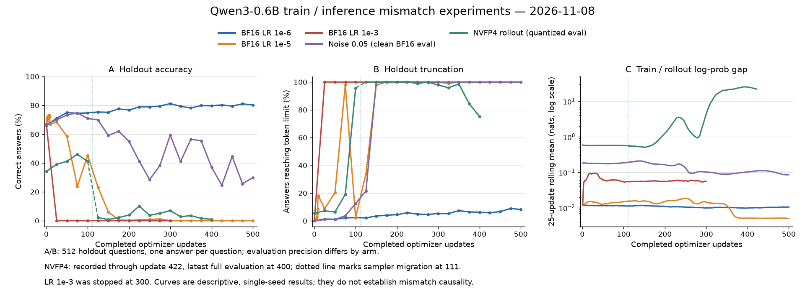

# 1108：训推不一致实验配置、执行指令与当前结果

更新日期：**2026-11-08，Asia/Shanghai**。代码分支：`tim/base`；统一入口对应提交：`58043aaa`。

当前已经观察到明显的 RL 性能崩坏：BF16 的 LR1e-5 最终准确率为0%，固定噪声组最终为29.88%，NVFP4 rollout 组也出现持续低准确率。
**这些现象尚不能全部归因于训推不一致。** 下面同时记录实际配置、最新结果和仍缺少的对照。

本文的命令用于通过整理后的统一入口创建**新实验**；结果来自此前各组的真实训练记录。
统一入口已通过49项CPU测试和7组原生参数预检，尚未重新完成GPU smoke。历史结果不等于新入口已经完成训练验证。

## 1. 当前配置总览

所有配置位于 [`examples/tim/configs/`](examples/tim/configs)。通过JSON区分实验，训练实现共用一份代码。

| 配置 | 训练端 | 采样端 | 在线验证端 | 恒定学习率 | 新训GPU数 | 历史结果对应情况 |
| --- | --- | --- | --- | --- | --- | --- |
| [`bf16_lr1e6.json`](examples/tim/configs/bf16_lr1e6.json) | BF16 | BF16 | BF16 | 1e-6 | 1 | 对应已完成500步的主baseline |
| [`bf16_lr1e5.json`](examples/tim/configs/bf16_lr1e5.json) | BF16 | BF16 | BF16 | 1e-5 | 1 | 已完成500步，额外评测并保存前10步 |
| [`bf16_lr1e3.json`](examples/tim/configs/bf16_lr1e3.json) | BF16 | BF16 | BF16 | 1e-3 | 1 | 历史按用户要求停在300步；配置原计划500步 |
| [`nvfp4_rollout.json`](examples/tim/configs/nvfp4_rollout.json) | BF16 | NVFP4模拟W4A4 | NVFP4模拟W4A4 | 1e-6 | 1 | 历史NVFP4长训练的单卡阶段 |
| [`fixed_noise_s005.json`](examples/tim/configs/fixed_noise_s005.json) | 干净BF16 | BF16＋固定权重噪声 | 干净BF16 | 1e-6 | 1 | 已完成500步 |
| [`nvfp4_rollout4_fresh.json`](examples/tim/configs/nvfp4_rollout4_fresh.json) | BF16 | 4个独立NVFP4 sampler | NVFP4模拟W4A4 | 1e-6 | 5 | 提供从头训练的拓扑；不能直接套用历史续训结果 |
| [`nvfp4_train_rollout.json`](examples/tim/configs/nvfp4_train_rollout.json) | NVFP4训练配方模拟 | NVFP4模拟W4A4 | NVFP4模拟W4A4 | 1e-6 | 1 | 当前统一协议尚未执行；更早100步实验另见附录 |

这里“推”主要指**训练过程中负责采样回答的SGLang引擎**，不一定等于最终评测或部署精度。
NVFP4 rollout组的在线验证也是模拟NVFP4；固定噪声组的验证则会恢复干净BF16权重。

## 2. 共同参数

| 参数 | 当前设置 |
| --- | --- |
| 模型 | 原始发布版Qwen3-0.6B，Dense，28层；从初始模型开始，不从其他学习率实验接着训 |
| 训练/采样框架 | Megatron / SGLang；训练引擎固定为Slime提交`0b0c277d5b4cc66efc3b6db269e2e5184e8f3b1e` |
| 依赖环境 | 本地已有`slimerl/slime:v0.4.0-cu129`镜像；启动时记录实际image ID，不自动下载或安装 |
| 数据 | GSM8K；在原始BF16模型8次采样中答对2—6次的训练题，共2784道 |
| 验证集 | 固定512道holdout，不按正确率筛选；与训练集无重叠 |
| RL算法/奖励 | GRPO；数学答案判分的0/1奖励 |
| 每次更新 | 16道题×每题8个回答＝128条回答；每个rollout对应一次optimizer更新 |
| global/micro batch | 128 / 1 |
| 计划更新次数 | 500；LR1e-3历史人工停在300，NVFP4续训链目前只记录到422 |
| 优化器 | AdamW；原生CLI为`--optimizer adam`，使用decoupled weight decay |
| 学习率 | 各组分别为1e-6 / 1e-5 / 1e-3，恒定，warmup=0，min_lr与lr相同 |
| weight decay / β / ε | 0.01 / (0.9,0.98) / 1e-8；保留Megatron对bias和一维参数的零衰减规则 |
| 梯度裁剪 | 原生默认`clip_grad=1.0` |
| token限制 | 最多1024个新token；总上下文2048；不是1024个汉字 |
| 训练采样 | temperature=1.0，top_p=1.0，top_k=-1 |
| 验证采样 | 每题1个回答，top_k=1；准确率分母为512条回答 |
| thinking / seed | `enable_thinking=false` / 42 |
| PPO/GRPO clipping | eps_clip=0.2，eps_clip_high=0.28 |
| 额外修正/损失 | 不启用TIS、RS、Score Centering、KL惩罚或entropy bonus |
| 并行 | 默认trainer TP=PP=CP=EP=1；四sampler配置为1张训练卡＋4张独立推理卡，不是trainer做TP4 |
| 后端 | trainer attention=`flash`，sampler attention=`flashinfer`；关闭prefill/decode CUDA graph及radix cache |
| 评测 | 初始0步及每25步；LR1e-5另加第1—10步评测 |
| checkpoint | 每步完整保存后原子发布best/last；LR1e-5额外保留前10步模型/Adam/RNG/数据游标 |

学习率比较目前不是严格逐题配对实验：LR1e-5增加了早期评测，同一全局seed不能保证采样轨迹一致。
如需严格对照，应让各组评测日程、拓扑和采样控制一致，并补独立seed。

### NVFP4模拟与固定噪声的具体含义

- **NVFP4 rollout**：线性层采用W4A4软件模拟，使用E2M1载荷、E4M3块scale与FP32 tensor scale；权重按16×16块、激活按1×16块处理。GEMM使用普通PyTorch/FP32计算。注意力、归一化和embedding lookup保留原路径。A100上没有获得原生NVFP4的速度或显存收益。
- **NVFP4训练配方模拟**：额外模拟线性层反向，包括随机舍入和RHT；参数存储仍为BF16，optimizer master/state为FP32。与“BF16训、NVFP4推”是两个不同实验。
- **固定噪声**：训练开始时生成`delta0 = 0.05 * Z * W0`，`Z ~ N(0,1)`，以FP32保存。每次同步使用`BF16(Wt + delta0)`；不重采样、不累计、不按当前权重重新缩放。bank seed为20261030，覆盖310个canonical learnable tensors，tied embedding/head共用扰动。
- **噪声组验证**：从缓存的干净BF16权重恢复后再评测，不通过“带噪BF16减去噪声”近似恢复。训练端本身不加噪声。

## 3. 执行前准备

在仓库根目录、Bash中设置以下变量。路径和GPU编号均为占位示例，请替换成自己的本地资产与实际空闲卡。
以下命令只需复用已有模型、筛选数据和镜像，无须重新下载。

```bash
TIM_MODEL=/path/to/Qwen3-0.6B
TIM_TRAIN=/path/to/gsm8k-correct2to6of8/train.jsonl
TIM_EVAL=/path/to/validation512.jsonl
TIM_RUNS=/path/to/new-tim-runs
TIM_NOISE_BANK=/path/to/existing-noise-bank

TIM_GPU=0
TIM_NV_GPUS=0,1,2,3,4

TIM_COMMON=(
  --model-path "$TIM_MODEL"
  --train-data "$TIM_TRAIN"
  --eval-data "$TIM_EVAL"
)
```

训练JSONL需要`prompt`、`label`及筛选metadata：`screen_samples=8`、`screen_correct_count`为2—6。
入口检查题数、数据哈希、重复题和训练/验证重叠；不会在筛选数据缺失时自动改用完整训练集。
支持HF cache的snapshot/blob相对链接，不需要复制一套权重。

先打印计划或进行CPU预检：

```bash
python3 examples/tim/run.py plan \
  --config examples/tim/configs/bf16_lr1e6.json \
  "${TIM_COMMON[@]}" \
  --output-dir "$TIM_RUNS/bf16-lr1e6-s42-1108"

python3 examples/tim/run.py preflight \
  --config examples/tim/configs/bf16_lr1e6.json \
  "${TIM_COMMON[@]}" \
  --output-dir "$TIM_RUNS/bf16-lr1e6-s42-1108"
```

`plan`只读并打印；`prepare`冻结代码和输入哈希；`preflight`在不暴露GPU的容器中检查真实Slime参数与hook。
`train`先预检最终bundle，再检查所选GPU无进程、显存≤64MiB且利用率为0，不自动排队。
每次独立实验使用新输出目录；对同一次已准备的实验，预检和正式训练可以使用同一目录，但配置和输入必须一致。

## 4. 各组正式训练指令

下面每个代码块都是一个独立实验，按需选择执行。它们从原始模型开始训练，不会自动恢复历史作业。

### 4.1 BF16训练／BF16采样，LR1e-6

```bash
python3 examples/tim/run.py train \
  --config examples/tim/configs/bf16_lr1e6.json \
  "${TIM_COMMON[@]}" \
  --output-dir "$TIM_RUNS/bf16-lr1e6-s42-1108" \
  --gpus "$TIM_GPU"
```

### 4.2 BF16训练／BF16采样，LR1e-5

```bash
python3 examples/tim/run.py train \
  --config examples/tim/configs/bf16_lr1e5.json \
  "${TIM_COMMON[@]}" \
  --output-dir "$TIM_RUNS/bf16-lr1e5-s42-1108" \
  --gpus "$TIM_GPU"
```

保留前10步完整checkpoint，并在这些步骤额外做512题评测，其后每25步评测。

### 4.3 BF16训练／BF16采样，LR1e-3

```bash
python3 examples/tim/run.py train \
  --config examples/tim/configs/bf16_lr1e3.json \
  "${TIM_COMMON[@]}" \
  --output-dir "$TIM_RUNS/bf16-lr1e3-s42-1108" \
  --gpus "$TIM_GPU"
```

配置计划500步；历史的300步是用户主动停止的位置，代码没有自动在300步停止的规则。

### 4.4 BF16训练／NVFP4模拟采样，单卡

```bash
python3 examples/tim/run.py train \
  --config examples/tim/configs/nvfp4_rollout.json \
  "${TIM_COMMON[@]}" \
  --output-dir "$TIM_RUNS/bf16-train-nvfp4-rollout-s42-1108" \
  --gpus "$TIM_GPU"
```

采样与在线评测均使用模拟NVFP4；训练重算和optimizer更新保持原生BF16。

### 4.5 BF16训练／NVFP4模拟采样，四sampler从头训练

```bash
python3 examples/tim/run.py train \
  --config examples/tim/configs/nvfp4_rollout4_fresh.json \
  "${TIM_COMMON[@]}" \
  --output-dir "$TIM_RUNS/bf16-train-nvfp4-rollout4-fresh-s42-1108" \
  --gpus "$TIM_NV_GPUS"
```

需要5张卡：1张trainer＋4个TP1 sampler，round_robin分发；每步仍为16×8。
**这是fresh start，不是从历史111/113步续训。** 统一入口当前不提供历史多卡迁移的自动恢复。

### 4.6 BF16训练／固定噪声采样，sigma0.05

```bash
python3 examples/tim/run.py train \
  --config examples/tim/configs/fixed_noise_s005.json \
  "${TIM_COMMON[@]}" \
  --noise-bank "$TIM_NOISE_BANK" \
  --output-dir "$TIM_RUNS/bf16-fixed-noise-s005-s42-1108" \
  --gpus "$TIM_GPU"
```

优先复用已验证同源的bank。没有bank时，在具有PyTorch和safetensors的环境中执行以下CPU工具；主机入口本身不要求安装这些包：

```bash
python3 examples/tim/prepare_noise_bank.py \
  --model-path "$TIM_MODEL" \
  --output-dir "$TIM_NOISE_BANK" \
  --seed 20261030 --sigma 0.05
```

工具存储未乘sigma的`eta=Z*W0`，运行时由配置乘sigma。已有完整bank会先校验再复用，不会覆盖不同来源或未完成的bank。

### 4.7 NVFP4训练配方模拟／NVFP4模拟采样

```bash
python3 examples/tim/run.py train \
  --config examples/tim/configs/nvfp4_train_rollout.json \
  "${TIM_COMMON[@]}" \
  --output-dir "$TIM_RUNS/nvfp4-train-rollout-s42-1108" \
  --gpus "$TIM_GPU"
```

这个新预设统一到2784题、16×8、500步；尚无该协议的GPU训练结果。附录的早期100步结果不能直接填到这一组。

### 4.8 小规模验证与待补对照

新入口首次GPU验证，可保留同一数据和batch，只减少到2次更新：

```bash
python3 examples/tim/run.py train \
  --config examples/tim/configs/bf16_lr1e6.json \
  "${TIM_COMMON[@]}" \
  --set training.updates=2 --set evaluation.interval=1 \
  --output-dir "$TIM_RUNS/bf16-smoke2-s42-1108" \
  --gpus "$TIM_GPU"
```

同wrapper零噪声对照的指令如下；**当前没有该对照的训练结果**：

```bash
python3 examples/tim/run.py train \
  --config examples/tim/configs/fixed_noise_s005.json \
  "${TIM_COMMON[@]}" \
  --noise-bank "$TIM_NOISE_BANK" \
  --set noise.sigma=0.0 --set 'name="bf16_fixed_noise_s000"' \
  --output-dir "$TIM_RUNS/bf16-fixed-noise-s000-s42-1108" \
  --gpus "$TIM_GPU"
```

其他参数覆盖示例：`--set training.seed=43`或`--set optimizer.lr=1e-5`；拼错字段会报错。
若把LR1e-5预设缩短到2步，还需把`evaluation.early_updates`和`evaluation.retain_early`都设为0。

## 5. 当前主要实验结果

数据重新核对于2026-11-08；**以下是验证集准确率，不是训练batch正确率**。
每个评测点为固定512题×每题1个回答；最高值指更新后的评测，不把初始模型算作最佳训练结果。

| 历史实验 | 已记录更新数／计划 | 评测精度 | 初始准确率 | 最佳训练后准确率 | 最新完整评测准确率 | 最新平均新token／截断率 |
| --- | --- | --- | --- | --- | --- | --- |
| BF16，LR1e-6 | 完成500／500 | BF16 | 66.02% | 81.25% @300 | **80.27% @500** | 462.86／8.20% |
| BF16，LR1e-5 | 完成500／500 | BF16 | 66.60% | 73.24% @7 | **0.00% @500** | 1024／100% |
| BF16，LR1e-3 | 用户停止300／500 | BF16 | 66.99% | 0.00% @25，此后也均为0 | **0.00% @300** | 1024／100% |
| BF16＋固定噪声0.05 | 完成500／500 | **干净BF16** | 66.99% | 74.80% @75 | **29.88% @500** | 1024／100% |
| BF16训／NVFP4推，单卡→四sampler续训 | 中断422／500 | **模拟NVFP4** | 34.18% | 46.09% @75 | **0.98% @400** | 850.31／75.20% |

截断率是达到1024个新token上限而未正常终止的回答数占比，分母同样为512。
截断100%不等于准确率0%：回答可能已给出正确答案，但仍继续生成。



图只连接实际记录的评测点；NVFP4没有400步之后的完整评测，不外推至422或500。
噪声组评测为干净BF16，NVFP4组评测为模拟NVFP4，不能把两条曲线当作统一部署精度的直接排名。

### 5.1 LR1e-5：从暂时回升发展为持续性能崩坏

| 完成更新数 | 验证正确题数／512 | 准确率 | 平均新token | 截断率 |
| --- | --- | --- | --- | --- |
| 0 | 341／512 | 66.60% | 235.68 | 0% |
| 7 | 375／512 | 73.24% | 432.24 | 5.27% |
| 50 | 299／512 | 58.40% | 602.20 | 20.31% |
| 75 | 122／512 | 23.83% | 1017.15 | 97.85% |
| 100 | 232／512 | 45.31% | 359.57 | 2.34% |
| 150 | 31／512 | 6.05% | 1014.31 | 97.85% |
| 175 | 3／512 | 0.59% | 1024 | 100% |
| 300 | 0／512 | 0% | 1024 | 100% |
| 500 | 0／512 | 0% | 1024 | 100% |

第100步曾部分恢复，但没有持续。第300—500步的每次计划评测均为0%，因此现在可以称为持续性能崩坏，不能继续沿用“113步时部分回升”的旧结论。
500次optimizer均执行成功，审计字段有限；246步有活跃梯度/参数变化，254步记录为全局零梯度，第339步起连续零梯度。
执行完成和`training-validation.passed=true`表示流程检查通过，不表示模型学得好。
这组改变了学习率，缺少消除训推误差的严格对照，尚不能把崩坏单独归因于训推不一致。

### 5.2 固定噪声：干净权重评测也发生退化

初始66.99%，75步最高74.80%，500步下降到29.88%。从150步起，所有计划评测的回答均达到1024上限。
评测时已切回干净BF16，因此退化不是“验证时继续加噪声”直接产生的表象；在带噪sampler参与的训练过程中，干净模型本身的评测表现也变差。
500步均有活跃更新，噪声审计验证了21次clean/noisy评测切换，未发现训练同步输入被原地修改。
这是目前研究固定采样扰动影响的主要结果，但仍需同wrapper零噪声和多个seed来完成更严格归因。

### 5.3 NVFP4：性能严重退化，但实验未完成500步

75步46.09%，100步41.02%且截断95.70%；125步已降到2.15%，150步0.78%，400步0.98%。
后期截断率并非始终100%，400步降至75.20%，但准确率仍很低；停止行为改善不能直接视为能力恢复。

历史轨迹必须按下面的分段理解：

```text
原单卡更新1—111
  → 恢复111步checkpoint，改成4个sampler
  → smoke续训112、113
  → 正式续训114—422
```

原单卡另外跑出的112步是被舍弃的并行分支，不重复拼入这条曲线。
111—113没有完整512题评测；不能声称切换多卡的瞬间导致准确率骤降。切换前100步已经存在严重截断，切换后还混有后续更新、采样batch与sampler RNG变化。

当前容器已退出：exit255，Docker记录`OOMKilled=false`，结束于**2026-11-07 10:26（北京时间）**。
状态文件中的`training`没有及时更新，最新记录为422步；没有500步评测，具体退出原因尚未确定。
422条optimizer记录均成功且审计字段有限，389步活跃、33步记录为全局零梯度。
尚未找到这条422步轨迹的统一干净BF16评测，不能据模拟NVFP4在线分数推断干净BF16模型也只剩0.98%。

## 6. 训推不一致指标及当前结论

指标`train/train_rollout_logprob_abs_diff`的含义：

> 对同一批已生成回答，比较训练引擎更新前重算的token log-prob与采样引擎记录的log-prob；每条回答先对有效回答token求平均绝对差，再对回答取平均。

单位为自然对数nats，测量对象会随当前策略生成的回答变化；它不是准确率，也不是完整词表分布的KL。
截断回答中的有效token仍会参与统计，指标不是简单把回答越长就累加得越大。

| 实验 | 最初25次更新的平均gap | 最后25次已记录更新的平均gap | 最后窗口 | 同期质量结论 |
| --- | --- | --- | --- | --- |
| BF16 LR1e-6 | 0.011674 | 0.010591 | 476—500 | 最终80.27%，能够持续学习 |
| BF16 LR1e-5 | 0.014642 | 0.005067 | 476—500 | 最终0%，gap下降不等于恢复 |
| BF16 LR1e-3 | 0.091358 | 0.055930 | 276—300 | 验证全错，绝大多数更新无学习信号 |
| 固定噪声0.05 | 0.178655 | 0.085816 | 476—500 | 干净评测退化至29.88% |
| NVFP4 rollout续训链 | 0.571192 | 22.042190 | 398—422 | 后期差异显著增大；最新完整评测仍很差 |

现有证据支持以下结论：

1. **BF16也存在训推不一致。** 但LR1e-6能从66.02%训练到80.27%，说明“有数值差异”不自动意味着训练崩坏。
2. **性能崩坏确实已经出现。** LR1e-5与1e-3均出现全错和学习信号消失；固定噪声组即便干净评测也明显退化。
3. **不能只看平均gap大小来判定崩坏，gap持续增大也不是这些退化过程的必要表现。** LR1e-5和固定噪声在退化后gap反而下降；回答内容、长度和退化分布变化都会影响这个动态指标。
4. **NVFP4后期误差增大是真实记录，但不能直接解释第一次性能崩塌。** 125步第一次低准确率时，gap尚稳定或略降；后期误差与策略退化的因果方向仍需控制实验。
5. **下一步应完成因果对照。** 优先同wrapper零噪声、多seed、固定checkpoint的共同BF16评测、相同token前缀重算，以及固定111步模型的单/四sampler无更新比较。本文没有启动这些作业。

## 7. 结果文件与查看方式

本次可分享的结果快照：

- [完整评测点、gap序列和证据文件哈希](examples/tim/results/20261108/results.json)
- [曲线图](examples/tim/results/20261108/results-overview.png)及[绘图代码](examples/tim/results/20261108/plot_results.py)
- [统一入口此前的CPU验证记录](TIM_VALIDATION.json)

历史结果的实验标识如下。标识不绑定某台机器的数据盘位置；查找这些目录的`runs/formal500`即可对应原始记录。

| 实验 | 历史实验目录标识 |
| --- | --- |
| BF16 LR1e-6 | `bf16-grpo-500-20261030` |
| BF16 LR1e-5 | `bf16-grpo-lr1e5-500-20261103` |
| BF16 LR1e-3 | `bf16-grpo-lr1e3-500-20261102` |
| 固定噪声 | `bf16-fixed-noise-500-20261030` |
| NVFP4原单卡 | `bf16-train-nvfp4-rollout-500-20261030` |
| NVFP4多sampler续训 | `bf16-train-nvfp4-rollout4-resume-20261102`；另包含`smoke-resume2` |

核对结果时联合查看`status.json`、`evaluation-metrics.json`、`training-metrics.json`、`optimizer-validation.jsonl`、`training-validation.json`及`logs/train.log`。
对没有完整结束的作业，还应核对容器状态，不能只依赖可能过期的`status.json`。

新入口的TensorBoard事件位于各自输出目录的`tensorboard/`：

```bash
tensorboard --logdir "$TIM_RUNS/bf16-lr1e6-s42-1108/tensorboard" --port 6006
```

使用SSH时转发远端对应端口，再在本机浏览器打开`http://127.0.0.1:6006/`。此命令用于新输出目录，不会自动汇总历史作业。

## 附录：早期NVFP4训练配方模拟的100步结果

早期作业`formal-dp4-20261025-retry-003`已经完成100步，但使用**完整6961道训练题、8×8/global64、trainer DP4、LR1e-6、weight decay0.1、β=(0.9,0.98)**。
其数据、batch、并行和weight decay均不同于本文2784题/16×8/500步主线，不能把它当成当前新预设的结果。

| 评测记录 | 精度 | 正确题数／512 | 准确率 | 平均新token | 截断率 |
| --- | --- | --- | --- | --- | --- |
| 100步在线训练评测 | 模拟NVFP4 | 222／512 | 43.36% | 549.99 | 31.84% |
| 独立冻结诊断：初始模型 | BF16 | 345／512 | 67.38% | 240.63 | 0% |
| 独立冻结诊断：100步模型 | **干净BF16** | 379／512 | **74.02%** | 269.75 | 0.98% |
| 同一100步模型的独立诊断 | 模拟NVFP4 | 243／512 | 47.46% | 544.46 | 30.66% |

独立诊断和在线评测是不同执行记录，43.36%与47.46%不混为同一点。
这组结果表明评测精度会显著改变该历史checkpoint的表现；**74.02%不属于当前422步的NVFP4 rollout轨迹**，也不能用来说明那条轨迹已经恢复。
